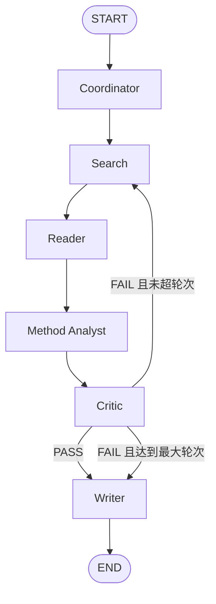

# 成员1：系统架构 + Coordinator Agent 完成稿

## 1. 成员1承担的内容

成员1负责整个多智能体科研助手的“骨架”：定义 LangGraph 节点、节点连接关系、条件分支、共享 State、Coordinator Agent 与跨成员统一数据接口。

总体流程：



其中 Critic 形成反馈闭环：审核不通过时生成新的搜索需求并返回 Search；为避免无限循环，框架增加 `critic_round` 和 `max_critic_rounds`。

## 2. Graph 中的 Node

1. `coordinator`：拆解研究主题，输出调研范围、研究问题、检索方向、关键词和任务计划。
2. `search`：根据 Coordinator/ Critic 的检索需求查找真实论文，并完成筛选、去重、Top-K。
3. `reader`：解析论文并提取结构化内容。
4. `analyst`：进行论文分类、方法对比和技术路线归纳。
5. `critic`：检查证据是否充分、是否存在遗漏和过度推断。
6. `writer`：仅在审核通过或达到最大反馈轮次后生成最终报告。

## 3. 共享 State 设计

核心字段如下：

```python
ResearchState = {
    "topic": ...,
    "research_scope": ...,
    "research_questions": ...,
    "search_directions": ...,
    "search_keywords": ...,
    "research_plan": ...,
    "papers": ...,
    "paper_analysis": ...,
    "method_summary": ...,
    "critic_result": ...,
    "critic_round": ...,
    "max_critic_rounds": ...,
    "final_report": ...,
}
```

这样每个 Agent 都围绕同一个 State 读写，不需要成员之间临时转换不一致的数据类型。

## 4. Coordinator Agent

### 输入

- 用户研究主题 `topic`

### 输出

- `research_scope`
- `research_questions`
- `search_directions`
- `search_keywords`
- `research_plan`

### 示例：Multimodal Time Series Forecasting

研究问题：

1. 目前 Multimodal Time Series Forecasting 有哪些主要技术路线？
2. 时间序列与文本融合主要采用哪些方法？
3. 现有方法的主要局限是什么？

搜索关键词建议：

- `multimodal time series forecasting text`
- `time series language model`
- `time series text fusion`
- `multimodal temporal forecasting`
- `cross attention time series text`
- `LLM multimodal time series forecasting`

Coordinator 本身不编造论文，只负责任务规划；真实论文必须由 Search Agent 返回。

## 5. 条件路由逻辑

Critic 的输出统一包含：

```json
{
  "decision": "PASS | FAIL",
  "new_search_queries": []
}
```

路由规则：

```text
PASS -> Writer -> END
FAIL + critic_round < max_critic_rounds -> Search
FAIL + critic_round >= max_critic_rounds -> Writer（带未完全通过警告）-> END
```

增加最大轮次的原因是防止 Critic 与 Search 之间无限循环。

## 6. 与其他成员的接口

- 成员2只需实现 `search_node(state) -> dict` 并返回 `papers`。
- 成员3只需实现 `reader_node(state) -> dict` 并返回 `paper_analysis`。
- 成员4只需实现 `analyst_node(state) -> dict` 并返回 `method_summary`。
- 成员5只需实现 `critic_node(state) -> dict` 并返回 `critic_result`。
- 成员6只需实现 `writer_node(state) -> dict` 并返回 `final_report`。

成员1的 `build_research_graph(...)` 负责把这些节点统一接到 LangGraph 中。

## 7. 运行方式

```bash
python -m venv .venv
# Windows
.venv\Scripts\activate
pip install -r requirements.txt
copy .env.example .env
python main.py "Multimodal Time Series Forecasting"
```

没有配置 API Key 时 Coordinator 自动使用 fallback，仍可完成 Graph 架构联调。配置 LLM 后可生成任意主题的动态研究问题与检索计划。

## 8. 联调时的验收标准

1. 用户只输入一个 `topic` 即可启动 Graph。
2. Coordinator 输出必须是结构化字段，不能只返回一大段自然语言。
3. Search 返回的论文必须是真实检索结果；后续 Agent 不得自行虚构论文。
4. 每个 Agent 只更新约定字段，数据格式遵守 `INTERFACES.md`。
5. Critic FAIL 能返回 Search，并携带补充搜索查询。
6. Critic PASS 后进入 Writer 并结束。
7. 系统有最大反馈轮次，避免死循环。

## 9. PPT 可直接使用的 5 页内容

### 第1页：成员1职责
- LangGraph 总体架构
- ResearchState
- Coordinator Agent
- Agent 路由逻辑
- 统一数据接口

### 第2页：系统工作流
放置流程图：Coordinator → Search → Reader → Analyst → Critic → Writer；FAIL 回 Search。

### 第3页：ResearchState
展示核心字段，并强调所有成员按同一 JSON/State 格式读写。

### 第4页：Coordinator Agent
输入 topic；输出 scope / questions / search directions / keywords / plan。展示 Multimodal Time Series Forecasting 示例。

### 第5页：Critic 反馈闭环与系统结束条件
- PASS -> Writer -> END
- FAIL -> Search
- 最大反馈轮次避免无限循环
- 体现 Multi-Agent 的“自检查”能力
